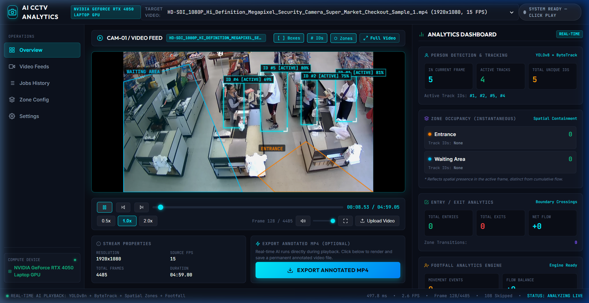
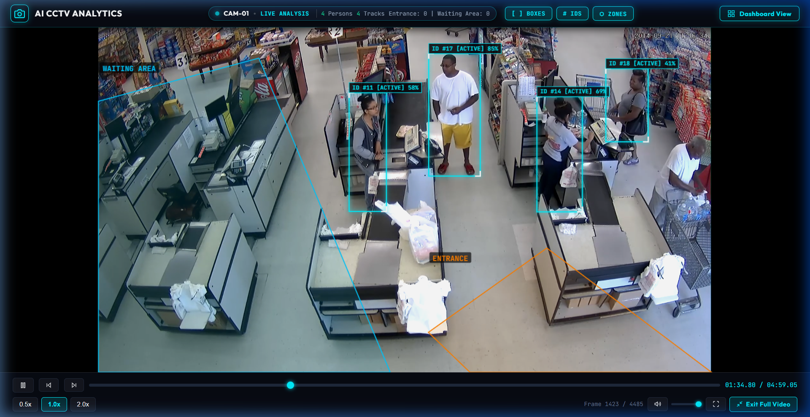
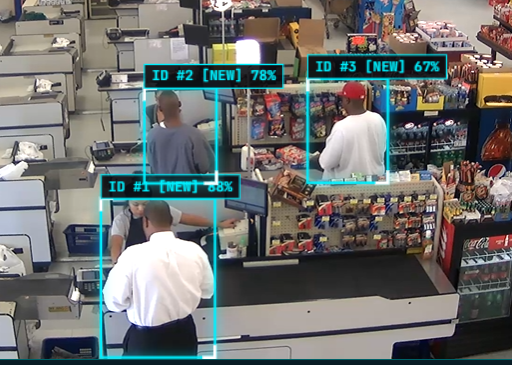
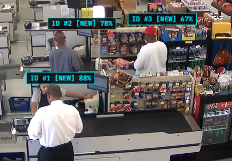
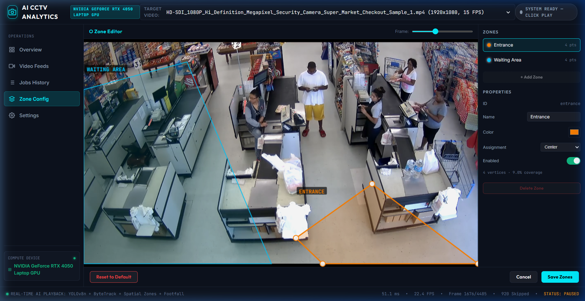
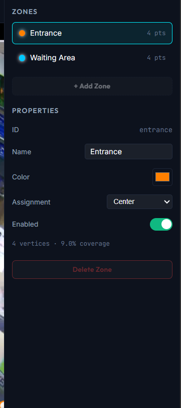
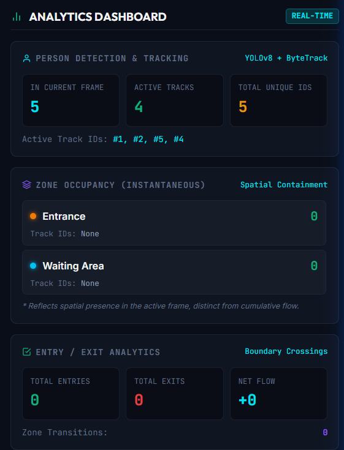

# AI CCTV Video Analytics Platform

**Version:** 0.9.0 | **Status:** Active Development — Phase 9 Complete, Phase 10 Upcoming

A modular, GPU-accelerated AI CCTV Video Analytics platform built with Python, YOLOv8, ByteTrack, FastAPI, and a JavaScript-based real-time dashboard. Processes surveillance video files to deliver person detection, multi-object tracking, spatial zone analytics, entry/exit flow, and footfall metrics with a live browser-based dashboard.

---

## 1. Current Development Status

> **Audit Date:** October 2026 | **Evidence:** Live API verification + 110 passing tests + full source code inspection

| Phase | Description | Status |
|---|---|---|
| Phase 1 | Environment & Project Foundation | COMPLETE |
| Phase 2 | CCTV Video File Reader | COMPLETE |
| Phase 3 | YOLOv8 Person Detection + CUDA | COMPLETE |
| Phase 4 | ByteTrack Multi-Object Tracking | COMPLETE |
| Phase 5 | Track State Manager | COMPLETE |
| Phase 6 | Zone Engine | COMPLETE |
| Phase 7 | Zone Counting / Occupancy Engine | COMPLETE |
| Phase 8 | Entry / Exit Analytics Engine | COMPLETE |
| Phase 9 | Footfall Analytics Engine | COMPLETE |
| Phase 9.5 | FastAPI Backend + Real-Time Dashboard | COMPLETE |
| Phase 10 | Queue Analytics, RTSP, Persistence | NOT STARTED |

---

## 2. Key Capabilities (Verified)

- **Real-Time AI Inference**: YOLOv8n on NVIDIA RTX 4050 via CUDA 12.8 — ~27-33 ms/frame
- **Multi-Object Tracking**: ByteTrack with persistent unique Track IDs across frames
- **Track Lifecycle Management**: NEW -> ACTIVE -> LOST -> REMOVED state machine
- **Spatial Zone Analytics**: Configurable polygon zones with center/bottom_center point-in-polygon
- **Zone Occupancy**: Real-time instantaneous head count per zone per frame
- **Entry / Exit Detection**: Directional boundary crossing (ENTRY / EXIT / ZONE_TRANSITION)
- **Footfall Analytics**: Cumulative totals, net flow, 15-min time-bucket rates, entrance breakdown
- **Live Dashboard**: Browser HTML5/JS dashboard — bounding boxes, Track IDs, zone polygons overlay
- **Video Upload**: Drag-and-drop MP4/AVI/MOV/MKV with ffmpeg faststart optimization
- **Full Video Mode**: Near-fullscreen video with inline layer controls
- **Zone Configuration Editor**: Visual polygon editor with interactive vertex manipulation and zone customization
- **Test Suite**: 110 tests, 100% passing

---

## 📸 Project Screenshots

Visual documentation of the AI CCTV Video Analytics platform showing the real-time dashboard, AI inference overlay, interactive zone editor, and occupancy analytics.

### Main Dashboard Overview

Overall CCTV monitoring dashboard displaying the real-time video feed, YOLOv8 person detection bounding boxes, ByteTrack tracking IDs, spatial zone polygons, GPU compute status, stream properties, and the real-time analytics panel.



### Live Monitoring (Full Video Mode)

Dedicated near-fullscreen CCTV monitoring layout designed for SOC operators, featuring an integrated HUD status bar (`CAM-01 • LIVE ANALYSIS • Person & Track counts`), interactive layer toggles (`[ ] BOXES`, `# IDS`, `⬡ ZONES`), and distraction-free surveillance visualization.



### Real-Time Person Detection & Multi-Object Tracking

High-precision YOLOv8 person detection paired with ByteTrack multi-object tracking. Visualizes bounding boxes, confidence scores, and persistent Track IDs (`ID #1`, `ID #2`, `ID #3`) across challenging retail surveillance camera angles.



### Multi-Object Tracking ID Visualization

Detailed tracking status visualization showing assigned track IDs, detection states (`[NEW]`, `[ACTIVE]`), and real-time bounding box association.



### Interactive Zone Management & Configuration

Built-in polygon Zone Editor interface allowing operators to visually inspect and manipulate spatial detection zones (`Entrance`, `Waiting Area`) on the CCTV frame, configure anchor assignment (Center / Bottom Center), toggle zone activity, and adjust vertex points.



### Zone Configuration & Anchor Properties

Dedicated zone properties sidebar displaying point counts, active vertex geometry, coverage percentages, color tags, and anchor point assignment (Center / Bottom Center).



### Real-Time Occupancy & Entry/Exit Analytics

Dedicated analytics dashboard displaying instantaneous head counts per spatial zone, active tracking statistics, directional entry/exit boundary crossings, and footfall movement telemetry.



---

## 3. Verified Architecture

```
CCTV Video File (.mp4 / .avi / .mov / .mkv)
           |
   VideoFileReader (OpenCV cv2.VideoCapture)
           |
   Frame Object (numpy BGR array + frame_number + timestamp)
           |
   YOLOPersonDetector (YOLOv8n — CUDA / CPU fallback)
           |
   DetectionResult (class_id=0, bbox xyxy, confidence)
           |
   ByteTrackPersonTracker (BYTETracker via ultralytics)
           |
   TrackingResult (track_id, bbox xywh, confidence)
           |
   TrackStateManager (NEW -> ACTIVE -> LOST -> REMOVED)
           |
   TrackStateResult (state per track_id)
           |
   ZoneEngine (cv2.pointPolygonTest polygon containment)
           |
   ZoneResult (zone_id per track — ENTERED / LEFT / INSIDE / OUTSIDE)
           |
   ZoneCountingEngine (per-zone occupancy head count)
           |
   ZoneCountingResult (occupancy dict, ZONE_ENTER / ZONE_EXIT events)
           |
   EntryExitEngine (from/to zone transition rule matching)
           |
   EntryExitResult (ENTRY / EXIT / ZONE_TRANSITION events)
           |
   FootfallAnalyticsEngine (cumulative totals + time buckets)
           |
   FootfallResult (entries, exits, net flow, buckets, entrance breakdown)
           |
   FastAPI Playback Service (/api/playback/*)
           |
   JavaScript Dashboard (player.js + analytics.js + app.js)
           |
   Browser — Live Canvas Overlay (Boxes + Track IDs + Zone Polygons)
```

---

## 4. Repository Structure (Verified)

```
ai-cctv-platform/
|
|-- main.py                     # CLI entry point; pipeline runner (--run flag)
|-- run_server.py               # FastAPI server launcher (uvicorn)
|-- config.yaml                 # Central configuration (zones, detection, tracking)
|-- requirements.txt            # Python dependencies
|-- .env.example                # Environment variable template
|-- yolov8n.pt                  # YOLOv8n model weights (6.5 MB, COCO, root-level)
|
|-- data/
|   |-- videos/                 # Input CCTV video files (9 videos present)
|   |-- outputs/                # Annotated video exports from pipeline jobs
|   |-- models/                 # Model weight path per config.yaml (currently empty — fallback to root)
|   `-- configs/                # External zone/ROI configs (empty — configured via config.yaml)
|
|-- src/
|   |-- video_input/            # Phase 2: Video ingestion
|   |   |-- base.py             # BaseVideoReader abstract class
|   |   |-- file_reader.py      # VideoFileReader (OpenCV)
|   |   `-- models.py           # Frame, VideoMetadata, VideoNotFoundError
|   |
|   |-- detection/              # Phase 3: YOLO detection
|   |   |-- detector.py         # YOLOPersonDetector (CUDA/CPU, fallback recovery)
|   |   `-- models.py           # Detection, DetectionResult, InferenceError
|   |
|   |-- tracking/               # Phase 4+5: ByteTrack + State Manager
|   |   |-- tracker.py          # ByteTrackPersonTracker
|   |   |-- state_manager.py    # TrackStateManager (NEW/ACTIVE/LOST/REMOVED)
|   |   `-- models.py           # Track, TrackingResult, TrackStateResult, TrackState
|   |
|   |-- zones/                  # Phase 6+7: Zone Engine + Occupancy
|   |   |-- zone_engine.py      # ZoneEngine (polygon containment, transitions)
|   |   |-- counting_engine.py  # ZoneCountingEngine (per-zone head counts)
|   |   `-- models.py           # Zone, ZoneOccupancy, ZoneEvent, TrackZoneAssignment
|   |
|   |-- analytics/              # Phase 8+9: Entry/Exit + Footfall
|   |   |-- entry_exit_engine.py  # EntryExitEngine (ENTRY / EXIT / ZONE_TRANSITION)
|   |   |-- footfall_engine.py    # FootfallAnalyticsEngine (totals, buckets, net flow)
|   |   `-- models.py             # EntryExitEvent, FootfallBucket, FootfallSummary
|   |
|   |-- api/                    # FastAPI backend
|   |   |-- app.py              # FastAPI app, all routes and endpoints
|   |   |-- playback_service.py # Real-time playback session management
|   |   `-- pipeline_service.py # Background batch processing jobs
|   |
|   |-- web/                    # JavaScript dashboard
|   |   |-- index.html          # Single-page dashboard
|   |   |-- css/styles.css      # Full design system
|   |   `-- js/
|   |       |-- player.js       # Video player + canvas overlay rendering
|   |       |-- app.js          # API calls, video selection, upload, job control
|   |       `-- analytics.js    # Live metrics panel, events feed, zone occupancy
|   |
|   |-- rules/                  # Rule engine (NOT IMPLEMENTED — stub only)
|   |-- events/                 # Event dispatcher (NOT IMPLEMENTED — stub only)
|   |-- utils/                  # Utilities (NOT IMPLEMENTED — stub only)
|   `-- core/                   # Core abstractions (NOT IMPLEMENTED — stub only)
|
`-- tests/                      # Test suite — 110 tests, all passing
    |-- generate_test_video.py  # Synthetic 640x480 test.mp4 generator
    |-- test_video_reader.py
    |-- test_detector.py
    |-- test_tracker.py
    |-- test_tracker_state.py
    |-- test_zone_engine.py
    |-- test_zone_counting.py
    |-- test_entry_exit.py
    |-- test_footfall.py
    `-- test_playback_service.py
```

---

## 5. Technology Stack (Verified Versions)

| Component | Library | Verified Version |
|---|---|---|
| Python | CPython (Conda) | 3.11 |
| Deep Learning | PyTorch | 2.11.0+cu128 |
| CUDA Runtime | NVIDIA CUDA | 12.8 |
| Object Detection | Ultralytics YOLO | 8.4.174 |
| Object Tracking | ByteTrack (via ultralytics) | Bundled |
| Video I/O | OpenCV | 5.0.0 |
| Web Framework | FastAPI | 0.143.0 |
| ASGI Server | Uvicorn | >=0.28.0 |
| Configuration | PyYAML | >=6.0.1 |
| Environment | python-dotenv | >=1.0.1 |
| Testing | pytest | >=8.0.0 |
| Frontend | Vanilla HTML5/CSS/JS | — |

---

## 6. Hardware Requirements

| Requirement | Minimum | Tested Configuration |
|---|---|---|
| GPU | CUDA-capable NVIDIA GPU | RTX 4050 Laptop GPU (6GB VRAM) |
| CUDA | 11.8+ | CUDA 12.8 |
| RAM | 8 GB | 16 GB recommended |
| Python | 3.10+ | 3.11 (Conda) |
| Storage | 5 GB | — |

> **CPU Fallback**: The detector includes a CUDA error recovery path that reloads the model on CPU if the GPU context becomes corrupted (common after long uptime + subprocess interference).

---

## 7. Environment Setup

```bash
# 1. Create and activate Conda environment
conda create -n ai-cctv python=3.11 -y
conda activate ai-cctv

# 2. Install PyTorch with CUDA 12.8 support
pip install torch torchvision --index-url https://download.pytorch.org/whl/cu128

# 3. Install project dependencies
pip install -r requirements.txt
```

### Verify GPU and CUDA

```bash
python -c "import torch; print('CUDA:', torch.cuda.is_available(), '|', torch.cuda.get_device_name(0) if torch.cuda.is_available() else 'CPU only')"
```

Expected:
```
CUDA: True | NVIDIA GeForce RTX 4050 Laptop GPU
```

---

## 8. Model Weight Setup

YOLOv8n weights (`yolov8n.pt`, 6.5 MB) are already present in the project root. The application falls back to the root-level file if `data/models/yolov8n.pt` is not found.

To use a larger model (e.g., YOLOv8s):
1. Place the `.pt` file in `data/models/`
2. Update `config.yaml`:
   ```yaml
   detection:
     model_name: "data/models/yolov8s.pt"
   ```

---

## 9. Configuration Reference

All parameters are in `config.yaml`:

```yaml
app:
  version: "0.9.0"

detection:
  model_name: "data/models/yolov8n.pt"
  confidence: 0.40         # Detection confidence threshold
  iou: 0.45                # NMS IoU threshold
  device: "auto"           # 'auto' | 'cuda' | 'cpu'
  classes: [0]             # 0 = Person (COCO)

tracking:
  track_high_thresh: 0.5
  track_low_thresh: 0.1
  new_track_thresh: 0.6
  track_buffer: 30         # Frames before lost track is removed
  match_thresh: 0.8

track_state:
  max_missed_frames: 30

zones:
  enabled: true
  assignment_mode: "center"       # 'center' or 'bottom_center'
  boundary_policy: "inside"
  definitions:
    - id: "entrance"
      name: "Entrance"
      polygon: [[0,0],[320,0],[320,480],[0,480]]
    - id: "waiting_area"
      name: "Waiting Area"
      polygon: [[320,0],[640,0],[640,480],[320,480]]

entry_exit:
  enabled: true
  allow_initial_entry: false
  definitions:
    - id: "main_entrance"
      from: null     # null = outside all zones
      to: "entrance"
      type: "ENTRY"
    - id: "main_exit"
      from: "entrance"
      to: null
      type: "EXIT"

footfall:
  enabled: true
  bucket_minutes: 15
  deduplicate_events: true
```

> **Known Limitation**: Zone polygon coordinates are calibrated for 640x480 pixels. For other resolutions, zones do not auto-scale and must be manually reconfigured.

---

## 10. Starting the Application

### Web Dashboard (Recommended)

```bash
conda activate ai-cctv
python run_server.py
```

Open: **http://127.0.0.1:8000**

### CLI Pipeline (Batch)

```bash
# Run on default video
python main.py --run

# Run on specific video
python main.py data/videos/your_video.mp4
```

---

## 11. Using the Dashboard

1. **Select video** from dropdown or drag-and-drop upload (MP4, AVI, MOV, MKV)
2. **Click Play** to start real-time AI inference
3. **Layer Controls**: Toggle Boxes, Track IDs, and Zone polygon overlays
4. **Full Video Mode**: Click expand icon — header shows CAM status + layer toggles
5. **Analytics Panel** (right sidebar): persons, tracks, zone occupancy, entry/exit, footfall, events feed

### Playback Controls

| Control | Action |
|---|---|
| Play / Pause | Start/stop AI inference |
| Step Back / Forward | Move one frame |
| 0.5x / 1.0x / 2.0x | Playback speed |
| Seek bar | Scrub to position (resets tracking state) |
| Expand icon | Toggle Full Video Mode |
| Esc | Exit Full Video Mode |

---

## 12. API Endpoints (Verified)

Base URL: `http://127.0.0.1:8000`
Interactive docs: `http://127.0.0.1:8000/docs`

### Health & Config

| Method | Endpoint | Description |
|---|---|---|
| GET | /api/health | System health, CUDA status, active engines |
| GET | /api/config | Active configuration |
| GET | /api/videos | List videos with metadata |

### Video Management

| Method | Endpoint | Description |
|---|---|---|
| POST | /api/upload | Upload video (multipart/form-data) |
| GET | /media/videos/{filename} | Stream raw video (range-request) |
| GET | /media/outputs/{filename} | Stream annotated output video |

### Real-Time Playback

| Method | Endpoint | Description |
|---|---|---|
| POST | /api/playback/session | Create/get session; returns zones, initial frame |
| POST | /api/playback/{id}/play | Set playing state |
| POST | /api/playback/{id}/pause | Pause |
| POST | /api/playback/{id}/seek | Seek to frame; resets analytics state |
| POST | /api/playback/{id}/process_frame | Analyze a frame; returns detections, tracks, metrics |
| GET | /api/playback/{id}/stream | SSE stream (exists in backend; not yet used by client) |
| DELETE | /api/playback/{id} | Close session |

### Batch Pipeline Jobs

| Method | Endpoint | Description |
|---|---|---|
| POST | /api/jobs | Submit batch analysis job |
| GET | /api/jobs | List all jobs |
| GET | /api/jobs/{job_id} | Job status, metrics, final summary |
| GET | /api/jobs/{job_id}/frames | Frame-level detection data |

### Example: Create Playback Session

```bash
curl -X POST http://127.0.0.1:8000/api/playback/session \
  -H "Content-Type: application/json" \
  -d '{"video_filename": "test.mp4"}'
```

Response:
```json
{
  "status": "success",
  "session_id": "play_test_ee94f2",
  "fps": 30.0,
  "total_frames": 90,
  "device": "CUDA (NVIDIA GeForce RTX 4050 Laptop GPU)",
  "zones": [{"id": "entrance"}, {"id": "waiting_area"}],
  "initial_frame": {"detections_count": 1, "tracks": [], "metrics": {}}
}
```

---

## 13. Pipeline Processing Stages

### A. Video Input (src/video_input/)

- `VideoFileReader` wraps `cv2.VideoCapture` for local files
- Extracts `Frame(data, frame_number, timestamp)` per read call
- Raises `VideoNotFoundError` / `VideoOpenError` on failures
- Cleanup: `reader.release()` always called in `finally` blocks
- **RTSP**: NOT implemented — only `.env.example` placeholder exists

### B. Object Detection (src/detection/)

- `YOLOPersonDetector` wraps Ultralytics with `model.predict()`
- COCO class 0 (person) only; `classes=[0]` enforced
- Auto-selects CUDA -> CPU; configurable via `config.yaml`
- **CUDA Recovery**: On GPU context corruption, the `detect()` method:
  1. Clears GPU memory cache
  2. Attempts `model.to("cpu")`
  3. If that fails, reloads model weights fresh from disk on CPU
- Output: `DetectionResult` with list of `Detection(bbox_xyxy, confidence, class_id)`

### C. Object Tracking (src/tracking/)

- `ByteTrackPersonTracker` wraps `ultralytics.trackers.byte_tracker.BYTETracker`
- Internal `_DetectionsAdapter` bridges `DetectionResult` to BYTETracker format
- Assigns persistent integer Track IDs via Kalman filtering + IoU matching
- `TrackStateManager` manages: NEW -> ACTIVE -> LOST -> REMOVED
- `max_missed_frames=30`: Track removed after 30 consecutive misses


### D. Zone Engine (src/zones/zone_engine.py)

- `ZoneEngine` uses `cv2.pointPolygonTest()` for point-in-polygon membership
- Assignment point: center or bottom-center of bounding box (configurable)
- Detects ENTERED / LEFT zone transitions per track per frame
- Known Limitation: Polygons are in fixed pixels; no auto-scale for video resolution


### E. Zone Counting Engine (src/zones/counting_engine.py)

- Derives instantaneous per-zone occupancy from `ZoneResult`
- Emits `ZONE_ENTER` and `ZONE_EXIT` events on boundary crossings
- Returns `ZoneCountingResult` with `{zone_id: ZoneOccupancy(count, track_ids)}`

### F. Entry/Exit Analytics Engine (src/analytics/entry_exit_engine.py)

- Classifies directional movements via configured transition rules
- Rule types: ENTRY (null -> zone), EXIT (zone -> null), ZONE_TRANSITION (zone -> zone)
- `allow_initial_entry=False`: No retroactive ENTRY for persons present at startup
- LOST tracks do NOT generate EXIT events (only REMOVED clears zone state)
- Duplicate suppression: same track + same zone = zero repeated events

### G. Footfall Analytics Engine (src/analytics/footfall_engine.py)

- Aggregates cumulative entries, exits, net flow from EntryExitResult
- Filters out ZONE_TRANSITION events (not counted as footfall)
- Deduplicates by event_id to prevent double-counting
- Time buckets based on video-relative timestamps (not wall-clock time)
- Returns `FootfallSummary` with totals, net flow, per-bucket rates, entrance breakdown

---

## 14. Analytics Metrics Reference

| Metric | Source | Meaning |
|---|---|---|
| detected_persons | YOLO | Person bounding boxes in current frame |
| active_track_ids | ByteTrack + StateManager | IDs in NEW or ACTIVE state |
| total_unique_tracks | ByteTrack | Unique Track IDs seen since session start |
| occupancy | ZoneCountingEngine | Current head count per zone |
| total_entries | EntryExitEngine | Cumulative ENTRY events |
| total_exits | EntryExitEngine | Cumulative EXIT events |
| net_flow | FootfallEngine | entries - exits |
| total_zone_transitions | EntryExitEngine | Internal zone-to-zone movements |
| footfall_total | FootfallEngine | Total movement events |
| pipeline_fps | PlaybackService | AI inference frames per second |
| latency_ms | PlaybackService | End-to-end frame processing time |
| dropped_frames | PlaybackService | Frames skipped due to overload |

> **Important**: `occupancy` (current persons in zone) does NOT equal `net_flow` (cumulative entries - exits). Camera startup state, dropped tracks, and blind spots cause these values to diverge.

---

## 15. Zone Engine Limitations

- **Fixed resolution**: Polygons calibrated for 640x480. Other resolutions require manual reconfiguration.
- **No overlapping zone priority**: First-defined zone wins when zones overlap.
- **No boundary debouncing**: Rapid crossings at zone edges generate multiple events. No hysteresis.
- **No GUI zone editor**: Zones only editable via `config.yaml`. No in-dashboard drawing tool.

---

## 16. Running Unit Tests

```bash
conda activate ai-cctv
pytest tests/ -v
```

**Verified Result (Oct 2026):**
```
110 passed, 1 warning in 10.32s
```

| Test File | Tests | Coverage |
|---|---|---|
| test_video_reader.py | 8 | Open, read, seek, EOF, metadata |
| test_detector.py | 7 | YOLO init, detect, CUDA/CPU, errors |
| test_tracker.py | 10 | ByteTrack init, update, track IDs |
| test_tracker_state.py | 12 | State transitions, lifecycle, metrics |
| test_zone_engine.py | 15 | Zone init, polygon test, transitions |
| test_zone_counting.py | 15 | Occupancy counts, ZONE_ENTER/EXIT |
| test_entry_exit.py | 16 | ENTRY/EXIT/ZONE_TRANSITION rules |
| test_footfall.py | 18 | Totals, buckets, net flow, dedup |
| test_playback_service.py | 9 | Session create, process_frame, seek |

---

## 17. Feature Implementation Status

### COMPLETE (23 features — Verified)

- Video file reading (.mp4, .avi, .mov, .mkv)
- YOLOv8n person detection on CUDA GPU
- CPU fallback with model reload on CUDA context corruption
- ByteTrack multi-object tracking with persistent Track IDs
- Track lifecycle state machine (NEW -> ACTIVE -> LOST -> REMOVED)
- Polygon zone definition and point-in-zone containment
- Zone occupancy head counts per frame
- Entry / Exit classification with transition rules
- Footfall aggregation with time buckets and net flow
- FastAPI backend with full REST API
- Real-time playback session management (per-session isolated engines)
- Singleton shared YOLO detector across sessions (thread-safe, mutex-locked)
- Video upload with sanitization and ffmpeg faststart optimization
- Video streaming with HTTP range-request support
- Background batch pipeline job processing with per-frame export
- HTML5 JavaScript single-page dashboard
- Canvas overlay rendering (bounding boxes, Track IDs, zone polygons)
- Layer toggles (Boxes / Track IDs / Zones — synchronized between modes)
- Full Video Mode (near-fullscreen expansion with inline controls)
- Zone Configuration Editor UI (interactive polygon editor with vertex manipulation)
- Live analytics panel (persons, tracks, occupancy, entry/exit, footfall)
- Events feed in dashboard
- 110-test automated test suite — 100% passing

### PARTIALLY COMPLETE (5 features)

- **Zone Editor backend sync**: In-dashboard Zone Editor enables visual polygon vertex manipulation and client-side persistence (`zoneStore.js`), but automated two-way synchronization back to server `config.yaml` is pending.
- **Zone analytics panel**: `analytics.js` hardcodes zone element IDs (`zone-occ-entrance`, `zone-occ-waiting`). Adding/renaming zones in config.yaml requires matching HTML/JS changes.
- **SSE streaming endpoint**: Server-side SSE generator exists in `playback_service.py` but the JavaScript client (`player.js`) polls `process_frame` instead of using SSE.
- **Annotated video export**: Background pipeline jobs generate annotated MP4 files, but dashboard UI for playing back annotated output needs further integration.
- **Model weight path**: `config.yaml` points to `data/models/yolov8n.pt` but actual file is at project root. Code fallback works but the intended path is unpopulated.

### NOT IMPLEMENTED (11 features)

- RTSP / live camera stream support (`.env.example` placeholder only)
- Rule engine: `src/rules/` is a stub — no line crossing or intrusion detection
- Event dispatcher: `src/events/` is a stub — no notifications or webhooks
- Database persistence: SQLite/Redis referenced in `.env.example` but not connected
- Queue analytics (Phase 10 planned)
- Dwell time analytics
- Cross-camera tracking
- WebSocket real-time push (SSE endpoint exists but client ignores it)
- `src/utils/` — stub only, no geometry or visualization helpers
- `src/core/` — stub only, no shared abstractions
- API authentication / security middleware

---

## 18. Prioritized Development Roadmap

### P0 — Critical Fixes (Production Blockers)

| Task | Problem | Acceptance Criteria |
|---|---|---|
| Zone coordinate normalization | Zones break on non-640x480 video | Zones auto-scale to actual video resolution |
| Zone panel dynamic rendering | Dashboard hardcodes 2 zone IDs | Panel renders any N zones from API response |
| Model weight path consistency | data/models/ empty; silent fallback | Clear single canonical path; documented fallback behavior |

### P1 — High Priority (Core Completeness)

| Task | Problem | Acceptance Criteria |
|---|---|---|
| SSE client in player.js | Client polls per-frame instead of streaming | Client uses SSE; eliminates per-frame POST overhead |
| Zone boundary debouncing | Jitter causes repeated events at boundaries | Configurable N-frame hysteresis before event emission |
| Zone GUI editor | Zones only editable in config.yaml | Click-to-draw polygons on video canvas |
| Populate src/utils/ | Geometry helpers used ad-hoc | Shared point_in_polygon, draw_bbox, coordinate utilities |

### P2 — Medium Priority (Feature Extensions)

| Task | Acceptance Criteria |
|---|---|
| RTSP camera stream | RTSPVideoReader class; configurable stream URL |
| Database persistence | SQLite stores sessions, events, summaries across restarts |
| Rule engine (line crossing) | Configurable virtual tripwire line crossing detection |
| API authentication | Bearer token or API key middleware |
| Queue analytics | Queue length, wait time estimation |

### P3 — Low Priority (Polish & Scale)

| Task | Acceptance Criteria |
|---|---|
| Dwell time analytics | Per-track time-in-zone measurement |
| Alert / notification system | Configurable occupancy threshold alerts |
| WebSocket real-time events | WS endpoint pushes updates to browser |
| Multi-camera dashboard | Grid view for multiple simultaneous feeds |
| Docker deployment | Dockerfile + docker-compose.yml |

---

## 19. Troubleshooting

### "AI Engine Initialization Error" in Dashboard

**Cause**: Corrupted CUDA context after long server uptime or running pytest in another process.

**Fix**:
```powershell
# Find the process on port 8000
Get-Process -Id (Get-NetTCPConnection -LocalPort 8000).OwningProcess
Stop-Process -Id <PID> -Force

# Restart server (reinitializes a fresh CUDA context)
python run_server.py
```

### Video Plays But No Bounding Boxes

1. Open browser dev console (F12) and check for API errors
2. Verify API is alive: `GET http://127.0.0.1:8000/api/health`
3. Confirm status badge shows `ANALYZING` during playback (not `SYSTEM READY`)
4. Refresh the page and re-select the video

### CUDA Not Detected

```bash
python -c "import torch; print(torch.cuda.is_available(), torch.version.cuda)"
```

If False:
- Run `nvidia-smi` to verify GPU driver
- Reinstall PyTorch: `pip install torch torchvision --index-url https://download.pytorch.org/whl/cu128`

### Zone Polygons Don't Align With Video

Zones are calibrated for 640x480. Update `config.yaml` polygon coordinates to match your video resolution. Multiply each coordinate by `(actual_width / 640, actual_height / 480)`.

### Tests Fail After Updating Dependencies

```bash
python tests/generate_test_video.py
pytest tests/ -v
```

---

## 20. Security & Operational Considerations

| Risk | Current State | Mitigation |
|---|---|---|
| No API authentication | All endpoints open on localhost | Bind to 127.0.0.1 only; add API key middleware before production |
| Directory traversal | Mitigated: Path().name strips directory components | Verified in app.py upload and stream endpoints |
| Unlimited file upload | No max size limit on POST /api/upload | Add max_upload_size middleware for production |
| CUDA context sharing | Single shared detector with threading lock | Thread-safe via _inference_lock in SharedDetectorManager |
| In-memory analytics only | All data lost on server restart | Add SQLite persistence (P2 roadmap) |

---

## 21. Planned Future Phases

1. **Phase 10** — Queue Analytics: detection, length estimation, average wait time
2. **Phase 11** — RTSP Live Stream: RTSPVideoReader, reconnection, multiple concurrent streams
3. **Phase 12** — Persistence Layer: SQLite session/event storage, historical reporting
4. **Phase 13** — Rule Engine: virtual tripwires, intrusion zones, occupancy threshold alerts
5. **Phase 14** — Multi-Camera Dashboard: grid layout, per-camera analytics
6. **Phase 15** — Production Hardening: Docker, API authentication, rate limiting

---

## 22. Audit Summary

| Category | Count |
|---|---|
| COMPLETE features | 22 |
| PARTIALLY COMPLETE features | 4 |
| NOT IMPLEMENTED features | 12 |
| Test suite | 110 tests, 100% passing |
| Live API endpoints verified | 14 endpoints |
| Video files in data/videos/ | 9 files |
| Server status (at audit time) | Running — CUDA active (RTX 4050) |

**Most critical next action (P0)**: Zone coordinate normalization — current fixed-pixel zone polygons break for any video resolution other than 640x480, which affects zone occupancy, entry/exit, and all downstream footfall analytics for real-world CCTV footage.
